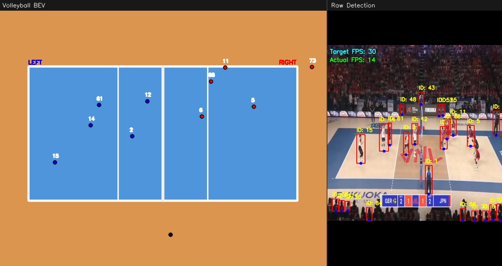
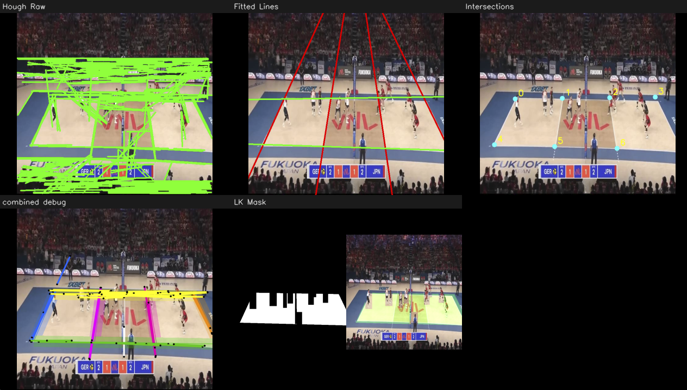
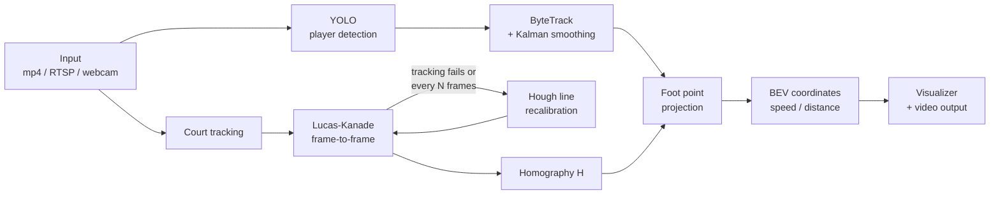

# PlayFieldCV - Real-to-BEV Mapper

Real-time player detection, tracking, and bird's-eye-view (BEV) court mapping for volleyball stream (images/video).




> **Status:** Phase 1 of a multi-phase project. Player tracking and BEV mapping work on
> the footage I've tested, but expect rough edges. See [Roadmap](#roadmap) and
> [Known limitations](#known-limitations).

## What it does (Phase 1 Pipeline)

Given a volleyball video (file, RTSP stream, or webcam), the pipeline:

- Selects the 4 court corners on the initial frame to compute the baseline homography matrix: **Top-Left, Top-Right, Bottom-Right, Bottom-Left**
- Detects players with **YOLO** and tracks them across frames with **ByteTrack** (via Ultralytics)
- Smooths player trajectories with a ***Delay Buffer***
- Estimates the image-to-court **homography** and updates it every frame as the camera pans
- Projects each player's foot position onto a metric **2D court canvas** (18 × 9 m)

## How it works



**Court calibration.** On the first frame, four court corners are selected manually
(`canvas/point_picker.py`) to compute the initial homography. After that, court points are
tracked frame to frame with Lucas-Kanade optical flow, and the homography is updated to
follow camera pan. When LK tracking degrades past a threshold, or every N frames, a
Hough-line detector re-detects the court lines and recalibrates.

**Projection.** Only the bottom-center of each player's bounding box (the feet) is projected,
because the homography is valid only for points on the ground plane.

## Roadmap

- [x] **Phase 1 — Player tracking & BEV mapping** (v0.1.0)
  - [x] YOLO player detection
  - [x] ByteTrack + smoothing
  - [x] Dynamic homography (LK tracking + Hough recalibration)
- [ ] **Phase 2 — Deep learning court keypoints** (replace manual init + Hough)
- [ ] **Phase 3 — Ball tracking** (TrackNet)
- [ ] **Phase 4 — Event classification & game state engine**
- [ ] **Phase 5 — Optimization** (ONNX / TensorRT export)

## Installation

```bash
git clone https://github.com/Hlinm-qq/PlayFieldCV-Real-to-BEV-Mapper.git
python -m venv .venv && source .venv/bin/activate
pip install -r requirements.txt
```

## Usage

Examples:
```bash
  python main.py --source path/to/match.mp4
  python main.py --source path/to/images/ --frame-count 200 --save-video
  python main.py --source 0 --manual-picker
   
```

## Configuration

| File | Purpose |
|------|---------|
| `config/volleyball_tracker.yaml` | Ultralytics tracker settings (ByteTrack thresholds, buffer size) |
| `config/volleyball.py` | Court dimensions, zones, and game properties |

## Project structure

```text
detection_stream/
├── main.py
├── data_manager/        # I/O: video/stream input, video/debug output
├── canvas/              # BEV drawing and manual corner picker
├── config/              # Tracker and court configuration
├── utils/               # Shared helpers
├── engine/
│   ├── detection/       # YOLO wrapper, Hough court detector, pre/post-processing
│   └── tracker/         # Court tracker, LK tracker, smoothing buffer
└── pipelines/           # Wires Source → Engine → Visualizer → Sink
```

## Known limitations

- Court initialization requires manual corner selection on the first frame.
- Hough recalibration assumes clearly visible court lines; it struggles with heavy occlusion,
  unusual floor colors, or strong motion blur.
- Tested mainly on a fixed or slowly panning camera; broadcast cuts, replays, and zoom
  changes are not handled yet.
- Track IDs can switch when players overlap closely (e.g. at the net). Appearance-based
  re-ID is planned.
- Players who jump are projected slightly incorrectly, since their feet leave the ground plane.
- No ball tracking yet (Phase 3).

## Acknowledgements

- [Ultralytics YOLO](https://github.com/ultralytics/ultralytics) for detection and tracking
- [OpenCV](https://opencv.org/) for optical flow, Hough transforms, and homography
- **Demo Dataset source:** [Roboflow](https://universe.roboflow.com/lohar/volleyball-lghq1/dataset/)

## License

The source code in this repository is licensed under the **MIT License** — see the [LICENSE](LICENSE) file for details.

*Note: Third-party dependencies used by this pipeline (such as Ultralytics) are subject to their respective licenses (e.g., AGPL-3.0).*